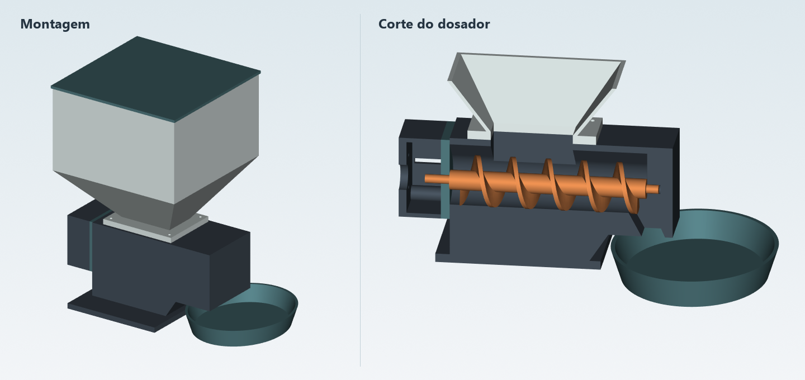

# Alimentador de 3 kg

Protótipo mecânico de sete peças, com funil sobre uma rosca sem-fim horizontal e tigela removível. O reservatório comporta **6,20 L úteis** até 10 mm abaixo da borda. Isso equivale a **3,10 kg** a 0,50 kg/L. A densidade aparente mínima para atingir 3 kg é de aproximadamente **0,484 kg/L**. Para conferir a sua, encha um recipiente de 1 L sem compactar e pese somente a ração.



## Visualização no CQ-Editor

Abra [alimentador.py](alimentador.py) e clique em **Render** (▶). As sete peças aparecem no painel **Objects**. Para ver a rosca por dentro, oculte `01-corpo` nesse painel. Se o arquivo já estava aberto antes da atualização, reabra-o para carregar o código da versão atual.

## Arquivos

- [Pacote com os sete STLs](export/alimentador-stl.zip) em milímetros e já orientados, também disponíveis na [pasta de exportação](export/stl).
- [Montagem STEP](export/alimentador.step) com as sete peças na posição de uso. Abra no FreeCAD ou em outro editor STEP.
- [Gerador CadQuery](alimentador.py) com os parâmetros de capacidade, garganta e rosca. Para regenerar no Windows com Python 3.12, execute na raiz do repositório:

```powershell
python -m venv .venv
.\.venv\Scripts\python.exe -m pip install -r 3d/requirements.txt
.\.venv\Scripts\python.exe 3d/alimentador.py
```

## Impressão

| Peça | Dimensões no fatiador em mm | Apoio na mesa |
| --- | --- | --- |
| 01 Corpo com bica | 214 × 184 × 120 | Base plana. Suporte sob a bica e, se necessário, nos furos horizontais. |
| 02 Reservatório | 208 × 208 × 218 | Flange do funil para baixo. |
| 03 Tampa | 212 × 212 × 8 | Face externa para baixo. |
| 04 Rosca | 46 × 46 × 210,5 | Ponta traseira para baixo. Use brim e suporte sob a hélice. |
| 05 Placa traseira | 76 × 90 × 8 | Face plana. |
| 06 Suporte do motor | 76 × 90 × 38 | Face de fixação do motor para baixo, abertura para cima. |
| 07 Tigela | 150 × 176 × 28 | Fundo plano. |

As peças cabem nominalmente em um volume de 220 × 220 × 220 mm. Confira os limites configurados e o espaço de brim no fatiador, principalmente no corpo, na tampa e no reservatório. Um ponto de partida com bico de 0,4 mm é camada de 0,20 mm, 4 perímetros e 15 a 20% de preenchimento no corpo. Confira o consumo estimado no fatiador. Use filamento declarado adequado pelo fabricante ao contato com alimento seco nas superfícies que recebem ração.

## Montagem

1. Limpe as rebarbas e prepare os oito pré-furos do corpo com macho M4. Fixe o funil ao corpo com quatro M4 × 16 mm. Com parafusos de sextavado interno, use uma Allen curta ou ponta baixa e reserve cerca de 8 mm acima da cabeça para manobrar a chave. Apoie a tampa sobre o encaixe.
2. Introduza a rosca pela traseira, encaixando a ponta de Ø8 mm no mancal cego frontal. Coloque a placa traseira sobre a outra ponta e gire a rosca à mão. A hélice tem Ø46 mm e passo de 32 mm, com folga radial nominal de 1 mm dentro da câmara. As pontas têm folga radial nominal de 0,30 mm nos mancais impressos.
3. O suporte adota a furação NEMA 17 de 31 × 31 mm, piloto de até Ø22 mm e eixo de Ø5 mm com cerca de 20 mm livres. Fixe o motor com quatro parafusos M3 que atravessem a placa de 7 mm e respeitem a profundidade de rosca do motor. Instale um acoplador 5 × 8 mm de aproximadamente Ø20 × 25 mm. O vão nominal de 4 mm entre as pontas deixa cerca de 10,5 mm de inserção de cada lado. Aperte o acoplador pela fenda lateral.
4. Fixe suporte e placa juntos ao corpo com quatro M4 × 55 mm. Posicione a tigela sob a bica. Acione em baixa rotação, inicialmente sem carga, no sentido anti-horário visto do motor em direção à tigela. Confira se a rosca leva a ração para a frente.

Para limpar, desconecte a alimentação, esvazie o funil, solte o lado de 8 mm do acoplador e remova os quatro M4 traseiros. A placa e a rosca saem por trás.

O modelo foi dimensionado para começar os ensaios com grãos secos de aproximadamente 6 a 12 mm. Faça os primeiros testes sob supervisão. Comece com pouca ração, meça a porção por volta e repita com até 3 kg. Confira travamento, vazamento com o motor parado, estabilidade do conjunto e alcance do pet pela bica antes de operar sem supervisão.
